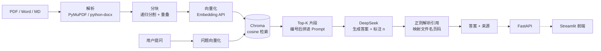

# 私有知识库 RAG 问答系统

> 企业文档智能问答：把 PDF / Word / Markdown 丢进来，用自然语言提问，答案附带原文出处（文件 + 页码）。
>
> 个人独立完成，从 0 到 1 实现检索、生成、接口、前端、容器化全链路。

## 效果示例

```
问题：迟到怎么算？

回答：每月迟到累计三次以上，扣除当月全勤奖金；迟到超过三十一分钟，
      按事假半天处理[1]。

      （资料中未说明不足三十一分钟时的处理方式）

来源：[1] 员工手册.md · 第1页
```

注意最后那句「资料中未说明……」。**答不出来就说不知道**，是本项目的核心设计之一。

## 功能

| 模块 | 能力 |
|---|---|
| 文档解析 | PDF / Word(.docx) / Markdown / TXT；扫描件自动识别并拦截 |
| 文本分块 | 递归分割（段落 → 句号 → 逗号逐级降级）+ 重叠窗口 + 标题路径前缀 |
| 向量化 | 任意 OpenAI 兼容 Embedding 服务（默认 bge-m3，免费） |
| 向量检索 | Chroma 持久化，显式 cosine 距离，Top-K 召回 |
| 问答生成 | DeepSeek 对话模型，强制只依据资料作答 |
| 引用溯源 | 片段编号 → 答案标注 `[n]` → 后处理映射回「文件名 + 页码」，越界编号丢弃 |
| 接口层 | FastAPI 5 个接口，自带 Swagger 文档 |
| 前端 | Streamlit 对话界面 + 文档管理 |
| 部署 | Docker 多容器编排，一条命令起全套 |
| 测试 | pytest 30 项，全部使用假模型，不依赖外部服务 |

## 架构



分层原则：解析、分块、向量化、检索、生成各自独立，换任何一层都不影响其他层。换 Embedding 服务只改 `.env` 三行。

## 技术选型与理由

| 环节 | 选择 | 为什么 |
|---|---|---|
| 文档解析 | PyMuPDF + python-docx | 解析快、页码准确，引用溯源依赖页码 |
| 分块 | LangChain 的 RecursiveCharacterTextSplitter | 优先在语义边界断开，避免句子被拦腰截断 |
| 向量库 | Chroma | 零配置、本地持久化，适合阶段 1；接口封装后可换 Milvus |
| Embedding | bge-m3（硅基流动，免费） | 中文效果好、1024 维、无需显卡 |
| LLM | DeepSeek | 中文强、价格低、OpenAI 兼容 |
| 接口 | FastAPI | 自动生成接口文档、Pydantic 参数校验 |
| 前端 | Streamlit | 不写 HTML/CSS 就能做交互页，把时间留给后端 |

> Embedding 与 LLM 都走 OpenAI 兼容协议，所以换平台只改配置，代码不动。

## 快速开始

### 1. 环境

- Python **3.13**（3.15 尚无 numpy/chromadb 轮子，装不上）
- 两个 API Key：
  - `LLM_API_KEY`：DeepSeek（<https://platform.deepseek.com/api_keys>）
  - `EMBEDDING_API_KEY`：硅基流动（<https://cloud.siliconflow.cn>，bge-m3 免费）

### 2. 安装

```bash
py -3.13 -m venv .venv
.venv\Scripts\activate                      # Windows
# source .venv/bin/activate                 # macOS / Linux

pip install -r requirements.txt -i https://pypi.tuna.tsinghua.edu.cn/simple
```

### 3. 配置

```bash
copy .env.example .env       # 或 cp .env.example .env
# 填两行：LLM_API_KEY / EMBEDDING_API_KEY
```

也可以用配置助手自动校验并写入：

```bash
python scripts/setup_keys.py
```

### 4. 跑起来

```bash
# 终端 1：接口服务
python -m uvicorn app.main:app --reload
# 打开 http://127.0.0.1:8000/docs 可以直接调接口

# 终端 2：网页界面
streamlit run app/ui/app.py
# 打开 http://localhost:8501
```

命令行快速体验（一条命令跑完整链路）：

```bash
python scripts/demo_ask.py
```

### 5. Docker 部署

```bash
docker compose up -d --build
```

| 服务 | 地址 |
|---|---|
| 接口文档 | http://localhost:8000/docs |
| 网页界面 | http://localhost:8501 |

数据通过 volume 挂载到宿主机 `./data`，容器重建不丢向量库。

## 接口

| 方法 | 路径 | 说明 |
|---|---|---|
| GET | `/health` | 健康检查，返回库内块数与模型名 |
| POST | `/api/documents` | 上传文档（解析 → 分块 → 向量化 → 入库） |
| GET | `/api/documents` | 文档列表（文件名 / 块数 / 页数） |
| DELETE | `/api/documents/{doc_name}` | 删除某文档的全部块 |
| POST | `/api/ask` | 提问，返回答案 + 引用 + 耗时 |

请求示例：

```bash
curl -X POST http://127.0.0.1:8000/api/ask \
  -H "Content-Type: application/json" \
  -d '{"question": "迟到怎么算？", "top_k": 5}'
```

## 关键设计

**1. 引用编号协议**

检索到的片段带 `[1][2][3]` 编号进 Prompt，要求模型在结论后标注编号；后处理用正则提取 `[n]`，映射回「文件名 + 页码」。越界编号（如只给了 3 条却标 `[9]`）直接丢弃，答案与来源必须对得上。

**2. 防幻觉三道闸**

- 检索为空 → 直接拒答，不调用模型；
- System Prompt 写死「只依据资料、必须标引用、资料不足就说不知道」；
- 后处理校验引用编号，越界丢弃。

**3. 测试不依赖外部服务**

Embedding 和 LLM 都用 Protocol 定义接口，测试注入 `FakeEmbedder` / `FakeChat`。30 项测试 2 秒跑完，0 成本、结果稳定，可直接进 CI。

**4. 标题路径注入**

Markdown 分块时把标题层级拼成 `员工手册 > 第一章 考勤制度 > 1.1 工作时间` 注入块首，块脱离原文后仍保有上下文，检索命中率明显提升。前缀占用字符预算会从 chunk_size 中扣除。

## 测试

```bash
python -m pytest -v
```

覆盖：解析器（含扫描件异常）、分块（重叠、标题继承、边界）、向量入库（持久化、cosine）、问答（引用解析、空库兜底）、接口（上传/列表/删除/问答）。

## 项目结构

```
rag-knowledge-base/
├── app/
│   ├── config.py              # 统一配置（.env 覆盖）
│   ├── main.py                # FastAPI 接口层
│   ├── ingestion/
│   │   ├── parsers.py         # 多格式解析 → Page(text, page_no)
│   │   └── chunker.py         # 递归分块 + 标题前缀
│   ├── rag/
│   │   ├── embedder.py        # 向量化（可插拔）
│   │   ├── vector_store.py    # Chroma 封装
│   │   ├── prompt.py          # Prompt 组装（引用编号协议）
│   │   ├── llm.py             # 对话模型（可插拔）
│   │   └── qa.py              # 问答管线 + 引用解析
│   └── ui/app.py              # Streamlit 前端
├── scripts/
│   ├── demo_ask.py            # 命令行体验
│   └── setup_keys.py          # 交互式配置 Key
├── tests/                     # 30 项 pytest
├── docs/                      # 架构设计与逐步讲解
├── Dockerfile
└── docker-compose.yml
```

## Roadmap

- **阶段 2（优化）**：BM25 + 向量混合召回（RRF 融合）· Cross-Encoder 重排 · HyDE 查询改写 · 多轮会话记忆 · 自建评测集（Recall@K / MRR）
- **阶段 3（生产化）**：Milvus / pgvector · OCR 扫描件 · 多租户与权限隔离 · Langfuse 链路追踪

## 说明

- `.env` 已在 `.gitignore` 中，密钥不会提交。
- 示例文档位于 `data/raw/员工手册.md`，可替换为自己的文档。
